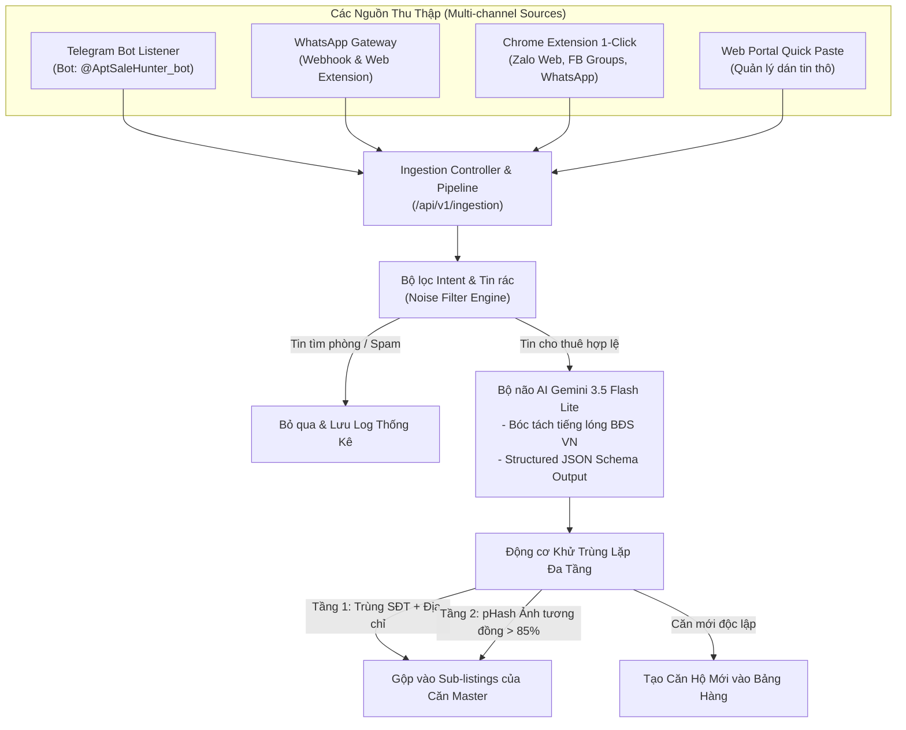

# EPIC-03: Thu thập Dữ liệu Đa kênh, Bóc tách AI & Khử Trùng lặp (Multi-channel Ingestion, AI Parsing & De-duplication)

## 1. Mục tiêu Tổng quan
Tự động hóa hoàn toàn quy trình đưa tin từ các hội nhóm **Telegram, WhatsApp, Zalo Web, Facebook Groups** vào hệ thống; sử dụng **Google Gemini 3.5 Flash Lite** để bóc tách văn bản tự do thành cấu trúc JSON chuẩn; ứng dụng thuật toán **Khử trùng lặp đa tầng (Deterministic Matching + Perceptual Image Hashing - pHash)** để loại bỏ bài trùng lặp và lọc bỏ triệt để tin rác.

---

## 2. Kiến trúc Tổng thể Hệ thống Ingestion

---

## 3. Danh sách User Stories Chi tiết

### User Story 3.1: Bộ não AI Bóc tách Tin BĐS & Lọc Tin Rác (Gemini LLM Parsing & Noise Filter)
* **Là một:** Hệ thống xử lý dữ liệu tự động.
* **Tôi muốn:** Dùng mô hình `Gemini 3.5 Flash Lite` với cấu hình Structured Output (JSON Schema) để đọc hiểu văn bản tin đăng tiếng Việt tự do và phân loại ý định (Intent Classification).
* **Để:** Chuyển đổi mọi bài đăng viết tắt, dùng tiếng lóng BĐS thành dữ liệu có cấu trúc hoàn chỉnh và loại bỏ hoàn toàn các tin "cần tìm phòng", tin quảng cáo rác trước khi lưu vào kho.
* **Tiêu chí chấp nhận (Acceptance Criteria):**
  1. **Lọc tin rác (Noise Filter):**
     * Tự động phát hiện các bài viết thuộc dạng: *Cần tìm phòng, Hỏi thăm phòng trọ, Quảng cáo đồ gia dụng, Vay tiền/Spam*.
     * Nếu không phải là tin **"Cho thuê căn hộ/phòng trọ"** $\rightarrow$ Đánh dấu trạng thái `REJECTED_NOISE` và dừng xử lý.
  2. **Trích xuất thông số BĐS tiếng Việt:**
     * **Tiêu đề gợi ý:** Rút gọn chuyên nghiệp theo chuẩn BĐS.
     * **Giá thuê (`price`):** Chuẩn hóa mọi định dạng (*6tr5, 6.5tr, 6500k, 6 triệu 500* $\rightarrow$ `6500000`).
     * **Tiền cọc (`deposit`):** Nhận diện từ *cọc 1 tháng, cọc 2 tháng, cọc 5tr* $\rightarrow$ số tiền cụ thể.
     * **Địa chỉ & Khu vực:** Tách riêng `address` (Số nhà, Ngõ, Đường) và `district` (Quận chuẩn tại Hà Nội: Cầu Giấy, Nam Từ Liêm, Đống Đa...).
     * **Thuộc tính phòng:** Số phòng ngủ (`bedrooms`), diện tích (`area`), loại phòng (*Studio, 1N1K, 2N1K, Duplex*).
     * **Tiện ích:** `elevator` (Thang máy), `allowPets` (Nuôi Pet), `carParking` (Ô tô đỗ cửa), `pcccStandard` (PCCC).
     * **Phí dịch vụ:** Điện (đ/kWh), Nước (đ/khối hoặc người), Dịch vụ chung.
     * **Đầu mối liên hệ:** Số điện thoại (`phone`) và Tên chủ nhà/môi giới.
  3. **Tốc độ & Độ tin cậy:**
     * Thời gian bóc tách trung bình dưới 1.2 giây/bài.
     * Cơ chế Fallback an toàn: Nếu bài đăng thiếu giá hoặc địa chỉ quá mơ hồ, gắn nhãn `NEEDS_REVIEW` để Quản lý kiểm tra nhanh trên giao diện.

---

### User Story 3.2: Khử Trùng lặp Đa tầng (Multi-tier Deduplication & Image pHash)
* **Là một:** Quản lý kho hàng và CTV môi giới.
* **Tôi muốn:** Khi có tin mới được đưa vào từ bất kỳ nguồn nào, hệ thống tự động kiểm tra xem căn hộ này đã có trong cơ sở dữ liệu hay chưa.
* **Để:** Bảng hàng luôn sạch sẽ, không bị nhân bản hàng chục lần cùng một căn hộ từ nhiều nguồn khác nhau.
* **Tiêu chí chấp nhận (Acceptance Criteria):**
  1. **Tầng 1 - So khớp Định danh (Deterministic Matching):**
     * Trùng số điện thoại đầu mối (`ownerContact.phone`) VÀ trùng tên đường/ngõ địa chỉ $\rightarrow$ Xác định trùng lặp 100%.
  2. **Tầng 2 - So khớp Ảnh Nhận thức (Perceptual Image Hash - pHash):**
     * Mỗi hình ảnh được tải về sẽ được tính toán mã băm 64-bit `pHash`.
     * So sánh khoảng cách Hamming (Hamming Distance) giữa ảnh mới và kho ảnh hiện có.
     * Nếu có từ **2 hình ảnh** trở lên đạt độ tương đồng $\ge 85\%$ với một căn hộ đã tồn tại $\rightarrow$ Xác định trùng lặp phòng.
  3. **Cơ chế Gộp Căn Master - Sub:**
     * Khi phát hiện trùng lặp: Không tạo căn hộ mới.
     * Tự động thêm bản ghi vào mảng `subListings` của căn Master (ghi nhận: Nguồn, Giá tại nguồn, Ngày đăng, Link gốc).
     * Cập nhật thời điểm tương tác gần nhất (`lastActivityAt`) của căn Master.

---

### User Story 3.3: Thu thập Đa kênh (Telegram Bot Listener, WhatsApp & Chrome Extension Gateway)
* **Là một:** Quản lý hệ thống.
* **Tôi muốn:** Tự động hóa việc thu thập bài đăng từ các nhóm **Telegram**, các nhóm **WhatsApp**, và bài đăng trên **Zalo Web / Facebook Groups**.
* **Để:** Không phải tốn từ 2-4 tiếng mỗi ngày copy thủ công từng bài đăng giữa các ứng dụng nhắn tin.
* **Tiêu chí chấp nhận (Acceptance Criteria):**
  1. **Telegram Ingestion (`@AptSaleHunter_bot`):**
     * Bot chạy nền chế độ Long Polling (không cần mở port công khai hoặc domain webhook phức tạp).
     * Lắng nghe bài đăng mới từ các nhóm/kênh Telegram được cấp quyền.
     * Hỗ trợ nhận tin được Forward từ các nhóm khác về nhóm nội bộ.
     * Tự động tải ảnh chất lượng gốc từ máy chủ Telegram đẩy lên Cloudinary và đưa vào hàng đợi bóc tách.
  2. **WhatsApp & Multi-source Ingestion Gateway:**
     * Endpoint bảo mật `POST /api/v1/ingestion/webhook` hỗ trợ nhận payload chuẩn từ WhatsApp Business API / Webhook bot.
     * Endpoint `POST /api/v1/ingestion/extension-import` dành riêng cho Chrome Extension: CTV/Quản lý chỉ cần 1 click trên giao diện Web (WhatsApp Web, Zalo Web, Facebook Group) để đẩy tin kèm album ảnh về hệ thống.
     * Endpoint `POST /api/v1/ingestion/quick-paste` trên giao diện Portal Web để Quản lý có thể dán trực tiếp đoạn văn bản thô dài vào phân tích ngay.

---

## 4. Công nghệ & Thư viện Triển khai
* **AI Model:** Google Gemini 3.5 Flash Lite (`@google/genai` hoặc Native Google REST API với Structured Output).
* **Telegram Bot:** `telegraf` hoặc `node-telegram-bot-api` (hoạt động theo chế độ Long Polling tối ưu tài nguyên).
* **Xử lý Ảnh & pHash:** `sharp` + thư viện tính Perceptual Hash (nhỏ gọn, hiệu năng cao, zero-bloat).
* **Lưu trữ Hàng đợi:** In-memory async worker queue gọn nhẹ theo triết lý Ponytail (không cần Redis cồng kềnh cho giai đoạn MVP).
